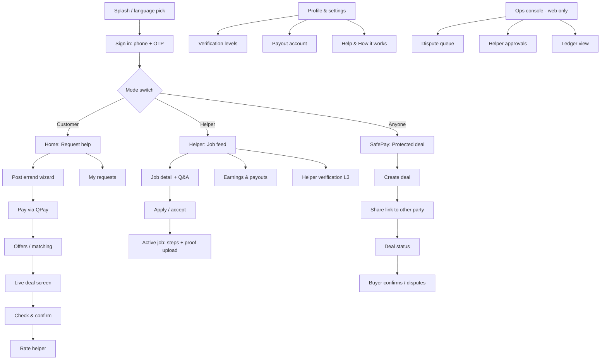
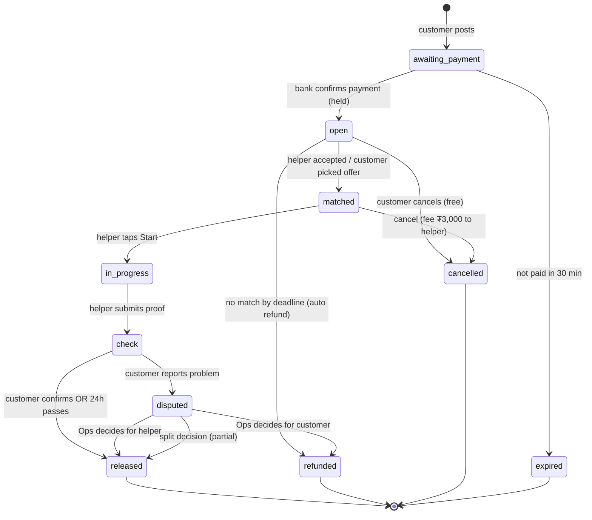
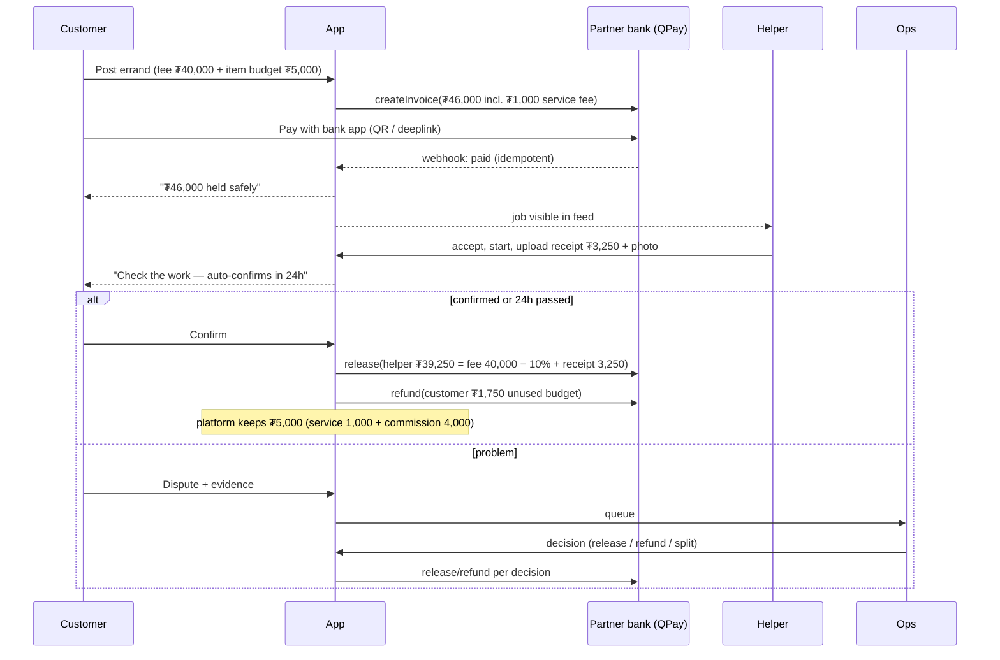
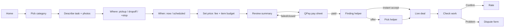
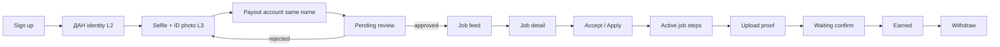
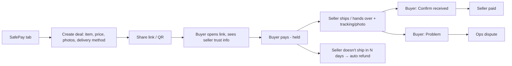

# UI-FLOWS.md — Tuslamj Hub (Errands + SafePay)

> Planning spec for the user interface. Read together with `CLAUDE.md` (business rules, money math, data model).
> CLAUDE.md says **what the system does**; this file says **what every screen looks like, says, and does**, including the small details.
> Working prototype: `prototype/index.html` (open in a browser; it is the source of truth for behaviour until the real app replaces it).

---

## 0. UI principles (apply to every screen)

1. **Money is always visible, always explained.** Any screen that touches money shows: the amount, **where it is right now** (“Held at bank”, “Released to helper”, “Refunded to you”), and **what happens next and when** (“Auto-releases in 23 h 12 min”).
2. **One primary action per screen.** One filled button at the bottom (thumb zone). Secondary actions are text buttons or a ⋯ menu.
3. **Status first, details second.** Every deal screen opens with a step tracker (like a delivery tracker), then the details.
4. **Never trap the user.** Every waiting state shows: what we're waiting for, how long, and a “Need help?” link.
5. **Mongolian first, English second.** All strings go through i18n keys from day one (`mn` default, `en` toggle). Numbers: `₮45,000` (thin grouping comma, ₮ before the number, no decimals).
6. **Plain words, not bank words.** Say “Held safely” not “Escrow”; say “Confirm it's done” not “Release funds”. The legal/bank terms live in the “How it works” page.
7. **Warn before danger, not after.** Phone numbers or “send me cash/transfer outside” in chat → inline warning *before* sending.
8. **Big touch targets** (min 44×44 px), readable at 16 px base, works on cheap Android phones and slow 4G (skeleton loaders, no heavy images).
9. **Every list has 3 extra states designed:** empty, loading (skeleton), error (retry button + plain message).
10. **Undo or confirm for anything irreversible.** Payment, release, cancel, dispute → bottom-sheet confirm showing the exact money result.

---

## 1. Sitemap

**Bottom tab bar (mobile):**

| Customer mode | Helper mode |
|---|---|
| Home · My requests · SafePay · Chat · Profile | Jobs · My jobs · Earnings · Chat · Profile |

Mode switch = pill toggle at top of Profile *and* long-press on the Home tab (Haejuseyo uses two tabs 해주세요/해줄게요; we use one switch so the tab bar stays at 5 items).

---

## 2. Deal state machine (what the UI must show for each state)

| State | Customer sees (badge + line) | Helper sees | Primary button |
|---|---|---|---|
| awaiting_payment | 🟡 “Waiting for payment” · “Pay within 29:41” | — (not visible) | **Pay ₮46,000** |
| open | 🔵 “Finding a helper” · “3 helpers viewed · 1 offer” | “New job · 1.2 km” | Customer: **View offers** / Helper: **Apply** |
| matched | 🔵 “Bat-Erdene is coming” · ETA | “Go to pickup” | Helper: **Start job** |
| in_progress | 🔵 “In progress” · step tracker | step checklist | Helper: **Upload proof & finish** |
| check | 🟠 “Check the work” · “Auto-confirms in 23:59:12” | “Waiting for confirmation” | Customer: **Confirm it's done** |
| disputed | 🔴 “Under review” · “Ops replies within 24h” | same | **Add evidence** |
| released | 🟢 “Done · ₮1,750 refunded to you” | “₮39,250 earned” | **Rate** |
| refunded | ⚪ “Refunded ₮46,000” | — | **Post again** |
| cancelled / expired | ⚪ grey | grey | **Post again** |

**Step tracker (top of live deal screen), 5 dots:** Paid → Matched → On the way / Working → Check → Done. Current dot pulses; finished dots show time stamp under them (“14:02”).

---

## 3. Money flow (sequence)

> The exact split formula and invariant (`helperNet + refund + platform == held`) are in CLAUDE.md. The UI **must** render the same numbers the ledger writes — compute once on the server, never in the client.

---

## 4. Flow A — Customer posts an errand

### C1 Home (customer)
- **Top:** greeting + district chip (“📍 Sükhbaatar, 3rd khoroo ▾”). Tapping opens address list.
- **Hero input:** big text field “What do you need help with?” with mic icon (voice input later). Typing here starts the wizard with the text pre-filled.
- **Category grid (2×3):** 🛒 Shopping · 📦 Carry/move · ⏳ Wait in line · 🚚 Deliver · 🔧 Fix · ✨ Other. Each tile shows “from ₮8,000”.
- **Active deal card** (if any) pinned above the grid: mini step tracker + one-line status. Tap → live deal.
- **Trust strip:** “Your money is held by [Bank] until you confirm” + small lock icon → How it works.
- **Recent / repeat:** “Do it again” chips from past requests (Lalamove-style saved addresses).
- Empty first-time state: 3-slide explainer card (Post → Helper does it → You confirm, money released) dismissible.

### C2 Post wizard (one question per step, progress bar at top “2 / 5”)
| Step | Fields | Small details |
|---|---|---|
| 1 What | Title (max 40 chars), description (max 500), up to 5 photos | Placeholder examples per category (“Buy 2 L milk and bread from Nomin supermarket”). Counter “23/40”. Auto-suggested title from first line. |
| 2 Where | Pickup, drop-off, **+ Add stop** (max 3) | Map pin + text landmark field (UB addresses are weak: “Blue door next to CU, 4th floor”). Saved addresses chips. Distance shown live. |
| 3 When | Now / Schedule (date + time window) / Flexible | “Now” shows “Usually matched in ~10 min” (when we have data). Night hours (22:00–07:00) show “Night minimum ₮6,000”. |
| 4 Price | Helper fee (stepper ±₮1,000, slider), item budget toggle (“Helper buys something for me”) | Shows suggested range by category + distance (“Similar tasks: ₮8–12k”). Below-min → inline red “Minimum ₮5,000”. Item budget explainer: “Helper spends up to this; unused amount comes back to you automatically”. |
| 5 Review | Summary card + money breakdown | Breakdown table: Helper fee / Item budget (max) / Service fee / **Total held**. Checkbox “I agree to rules” with link. Button **Pay ₮46,000**. |

- Draft auto-saves; leaving shows “Save draft?” sheet.
- Validation is per step; the Next button stays disabled with a reason line under it (“Add a pickup address”).

### C3 QPay pay sheet
- Bottom sheet: amount large, bank logos grid (Khan, Golomt, TDB, State, M Bank, Xac…) → deeplink; QR for paying from another phone.
- Countdown “Invoice valid 29:41”.
- After return from bank app: spinner “Checking with the bank…” (poll + webhook). Success → full-screen green tick “₮46,000 held safely” (1.5 s) → Finding helper.
- Failure states: “Payment not received yet” (Retry check / Choose another bank), “Invoice expired” (Create new invoice). Never double-charge: same deal reuses invoice if still valid.

### C4 Finding a helper / offers
- Radar animation + text “Showing to helpers within 3 km”. Counters: viewed · offers.
- **Instant mode:** first helper to accept wins (Haejuseyo instant). Screen jumps to live deal with a haptic + sound.
- **Scheduled mode:** up to 5 offers (MAX_APPLY). Offer card: photo, name, ✓ level badge, rating ★4.9 (32), trust score, jobs done, distance, short message, “Can start 15:00”. Buttons: **Choose** / view profile.
- Q&A tab (pre-match): public questions from helpers, customer answers; no private chat before match (Haejuseyo rule, cuts off-platform scams).
- Edit / cancel always available here (free while open). Raising the fee → “Raise fee to get faster match” nudge after 10 min with no offers.
- No match by deadline → auto refund, card “No helper found — ₮46,000 refunded” + **Post again with +₮2,000**.

### C5 Live deal
- Step tracker → helper card (photo, name, plate/vehicle if any, ★) → actions row: 💬 Chat · 📞 Call (masked number) · ⋯ (Cancel, Report).
- Map with helper location during on-the-way (later phase; MVP = status text).
- Timeline list (newest first): “14:02 Bat-Erdene accepted”, “14:20 Arrived at store”, “14:31 Receipt uploaded ₮3,250”.
- Receipt card when uploaded: photo thumbnail, amount, “Within your ₮5,000 budget ✓” or orange “Over budget by ₮500 — approve?” (approve / decline).
- Cancel after match → sheet showing exact consequence: “Cancel fee ₮3,000 goes to Bat-Erdene. ₮43,000 refunded.”

### C6 Check & confirm
- Proof gallery (photos, receipt, helper note).
- Money result preview **before** tapping: “Bat-Erdene gets ₮39,250 · You get back ₮1,750”.
- Primary **Confirm it's done** → confirm sheet → success.
- Secondary text button **Something's wrong** → dispute form.
- Countdown chip: “Auto-confirms in 23:59:12” with info icon: “If you do nothing, we'll release the money so helpers aren't left waiting.”
- Reminders: push at 12 h and 2 h left.

### C7 Rate
- 5 stars + quick tags (On time · Careful · Friendly · Good communication / Late · Rude · Item damaged).
- Optional text, optional tip (later, goes 100% to helper).
- Skip allowed; rating editable for 72 h.

### C8 Dispute form
- Reason radios: Not done · Done badly · Wrong item · Damaged · Overcharged · Other.
- Required note (min 20 chars), up to 5 photos.
- Shows what happens: “Money stays held. Ops reviews within 24 h. Both sides can add evidence.”
- After submit: deal shows red status + evidence thread.

---

## 5. Flow B — Helper

### H1 Verification (helper onboarding)
- Checklist screen with 4 rows, each with status chip (Done / In review / Needed): Phone ✓ · ДАН identity · Selfie + ID card · Payout account.
- ДАН: “Sign in with ДАН” button → gov flow → back with name + register number prefilled (read-only).
- Selfie: camera overlay oval, tips (“No glasses, good light”). ID card: front/back frame overlays, auto-crop.
- Payout account: bank picker + account number; warning “Name must match your ДАН name: БАТ-ЭРДЭНЭ”.
- Pending screen: “Usually reviewed within 24 h” + what you can do meanwhile (read helper guide, take quiz).
- Rejected: specific reason + **Retake** (never a generic “rejected”).

### H2 Job feed
- Filter chips: Distance (1/3/5/20 km) · Category · Now/Scheduled · Has item purchase.
- Card: category icon, title, **fee big** (“₮40,000”), distance, time (“Now” / “Tue 15:00”), “+ buys items up to ₮5,000”, posted ago, offers count “2/5 applied”.
- Badge “💰 Money already held” on every card (this is our helper-side selling point: no unpaid jobs).
- Empty: “No jobs nearby right now — turn on notifications / widen radius”.
- Online toggle at top (“Receiving jobs” on/off).

### H3 Job detail
- Map snippet, full description, photos, customer first name + ★ + jobs posted, Q&A (ask public question).
- What you'll earn: “Fee ₮40,000 − 10% = **₮36,000** + item costs reimbursed”.
- **Accept** (instant) / **Apply with message** (scheduled). Confirm sheet with rules recap (“Keep receipt”, “Don't ask for cash outside the app”).

### H4 Active job
- Checklist per category (shopping: Go to store → Buy → Upload receipt → Deliver → Upload delivery photo).
- Each step a big tap row; completing it posts a timeline event to the customer.
- Receipt upload: photo + amount field; over budget → requires customer approval before continuing.
- **Finish & submit proof** primary at bottom; disabled until required proof exists.
- Chat/call buttons, “Problem?” (customer not answering, store closed, item out of stock → suggested messages).

### H5 Earnings
- Big balance “Available ₮84,500” + “Held (waiting confirm) ₮36,000”.
- Withdraw button → to same-name account; shows fee tier and “arrives in ~1–2 days” (Haejuseyo style) or instant later.
- History list: per job net, commission shown transparently.
- Level card (later): jobs done → level, perks (lower commission).

---

## 6. Flow C — SafePay (protected deal between two people)

### S1 Create deal (seller or buyer can start)
- Toggle “I'm selling / I'm buying”.
- Item name, price, photos, condition, delivery (meet in person / courier / post), check window (default 3 days goods; Bunjang-style).
- Fee preview: “Buyer pays ₮1,000 protection fee (1%, min ₮1,000)”.
- Creates a link `tuslamj.mn/d/7KQ2` + QR + share sheet (Messenger, Viber, copy) — because Mongolian deals start on Facebook groups/Messenger.

### S2 Buyer landing (works on web without app install)
- Seller name (verified ✓ ДАН), trust score, deals completed, member since.
- Item card + **what protection means** in 3 bullets.
- Red warning box: “Never pay by direct transfer. If the seller asks you to pay outside this page, it's a scam.”
- **Pay ₮121,000 safely** → QPay.

### S3 Deal status (both sides, same screen, role-aware text)
- Tracker: Created → Paid (held) → Sent → Received → Paid out.
- Seller after payment: “Buyer paid — ₮120,000 is held for you. Send the item, then tap **I've sent it**” (+ tracking no./photo).
- Buyer after sent: **Confirm received** / **Problem**; countdown auto-confirm.

---

## 7. Flow D — Ops console (web, desktop)

- **Dispute queue:** table sorted by age; columns: deal id, type, amount held, reason, waiting time (red > 24 h). Detail view: both timelines, evidence, chat log (read-only), decision panel: Release all / Refund all / Split (slider with live money preview) + required note → writes ledger entries.
- **Helper approvals:** side-by-side ID photo vs selfie vs ДАН name; Approve / Reject with reason dropdown.
- **Ledger:** filters by deal/user/date; running bank balance must equal sum of held deals (red banner if not).
- Every Ops action logged with operator name + timestamp (shown on the deal timeline as “Ops decision”).

---

## 8. Sign-up & verification levels (UI view)

| Level | How | Unlocks | UI |
|---|---|---|---|
| L1 | Phone + OTP | Browse, post up to ₮100k | 2 screens: phone → 6-digit code (auto-read SMS on Android, resend after 60 s) |
| L2 | ДАН login | Post any amount, SafePay | “Verify with ДАН” card on profile; ✓ badge |
| L3 | Selfie + ID + review | Become helper | §5 H1 |
| L4 | Extra (vehicle docs, police clearance later) | Moving / high-value jobs | later |

Locked actions show a sheet: “Verify with ДАН to continue (1 min)” — not an error.

---

## 9. Chat & calls

- Chat opens **only after match** (or after SafePay payment). Pre-match = public Q&A.
- System messages inline in chat (grey pill): “Payment held ₮46,000”, “Receipt uploaded”.
- **Guard:** typing a phone number / bank account / “шилжүүл” (transfer) / “бэлнээр” (cash) → yellow banner above input: “Paying outside the app removes your protection.” Phone numbers masked on send.
- Quick replies per state (“I'm here”, “Store doesn't have it, alternative?”, “5 min late”).
- Call = masked/relay number (later); MVP = in-app button that reveals number only after match and logs the reveal.
- Chat read-only 24 h after completion, kept for Ops 90 days (Haejuseyo hides after 24 h).

---

## 10. Notifications (push + SMS fallback for money events)

| Event | To | Text (EN; MN in i18n file) |
|---|---|---|
| Paid/held | Customer | “₮46,000 is held safely. Finding a helper.” |
| Matched | Customer | “Bat-Erdene accepted your request.” |
| New job nearby | Helper | “New: Shopping · 1.2 km · ₮40,000” |
| Proof submitted | Customer | “Check the work. Auto-confirms in 24 h.” |
| 12 h / 2 h left | Customer | “2 hours left to check your errand.” |
| Released | Helper | “₮39,250 added to your balance.” |
| Refund | Customer | “₮1,750 refunded to your account.” |
| Dispute update | Both | “Ops decided on deal #1042. Tap to see.” |

---

## 11. Microcopy bank (start of i18n file)

| Key | MN | EN |
|---|---|---|
| status.held | Банкинд аюулгүй хадгалагдаж байна | Held safely at the bank |
| btn.confirm_done | Хийгдсэн, баталгаажуулах | Confirm it's done |
| btn.problem | Асуудал байна | Something's wrong |
| hint.auto_release | {time}-ийн дараа автоматаар баталгаажна | Auto-confirms in {time} |
| warn.offplatform | Апп-аас гадуур төлбөл хамгаалалт алга болно | Paying outside the app removes your protection |
| empty.feed | Ойролцоо ажил алга байна | No jobs nearby right now |
| err.network | Холболт тасарлаа. Дахин оролдох | Connection lost. Try again |

> MN strings are drafts — have a native speaker review tone (polite but not stiff; avoid bank jargon).

---

## 12. Design system starter

- **Colors:** Primary (trust blue/teal) · Success green (released) · Warning amber (check window) · Danger red (dispute) · Neutral grey (closed). Status colors are reserved — never use green for decoration.
- **Type:** one family with Cyrillic support (Inter / Noto Sans). Sizes 12/14/16/20/28; amounts use tabular numbers.
- **Components to build first:** Button, StatusBadge, StepTracker, MoneyBreakdown, DealCard, OfferCard, BottomSheet, Countdown, PhotoUploader, EmptyState, Skeleton, Toast.
- **Engagement (later, borrowed from M Bank / SocialPay):** helper levels, small streak rewards, theme colours; avoid forced daily updates (M Bank app-store complaint).

---

## 13. Reference apps — what to study and borrow

| App | Study | Borrow for |
|---|---|---|
| **Haejuseyo (해주세요)** | Customer/helper tabs, instant vs scheduled matching, Q&A before match, prepaid held fee, receipt proof | Core errand flow C2–C6, H2–H4 |
| **Airtasker** | Post task → offers → accept → payment held → release | Offer cards, task detail, “Release payment” screen |
| **TaskRabbit** | Category-first booking, tasker profiles, hourly pricing | Helper profile & reviews |
| **Lalamove** | Pickup/drop-off, **+Add stop**, vehicle choice, instant price before booking, “Help Buy” add-on, live tracking, in-app chat/call | Where/When/Price steps, item-budget add-on, live screen |
| **Karrot / Danggeun (당근)** | GPS neighbourhood verification, manner temperature 36.5°, 안심결제 safe payment held until 구매확정, AI draft + price suggestion from photos | Trust score, SafePay confirm step, price suggestion |
| **Bunjang (번개장터)** | 번개페이 escrow, auto-confirm after days, shipping tracking | SafePay status & auto-confirm |
| **Escrow.com** | Inspection period, step tracker, very explicit money states | SafePay status copy |
| **Soomgo (숨고)** | Request form → multiple quotes from pros | Scheduled-offer flow |
| **UBCab / Toki / TESO** | Local sign-up, ДАН, Mongolian copy & payment habits | Onboarding, MN microcopy |
| **QPay / SocialPay / M Bank** | Local pay sheets, bank deeplinks, engagement features | Pay sheet, success screens, levels |

### Where to actually see the screens (no Korean number needed)
- **Mobbin** (mobbin.com) — largest library of real app screens & full flows; search “Airtasker”, “TaskRabbit”, “Lalamove”, “escrow”, “checkout”, “onboarding”, “KYC”. Has an MCP server so Claude Code can query it.
- **Refero** (refero.design) — web + iOS, good filters by UX pattern; also MCP.
- **Page Flows** (pageflows.com) — video recordings of full journeys (best for seeing transitions).
- **Banani**, **Lazyweb** — free browse options.
- App store screenshots + YouTube “how to use [app]” walkthroughs for Korean apps (Haejuseyo, Danggeun, Bunjang, Soomgo).

**Study checklist per reference:** onboarding · empty states · how money/status is shown · cancel flow · dispute/report flow · notifications wording · how they stop off-platform payment.

---

## 14. Small-detail checklist (go through before each screen is “done”)

- [ ] Empty, loading (skeleton), error states designed
- [ ] Back button behaviour + draft saving
- [ ] Every amount formatted `₮12,345`, from server, matching ledger
- [ ] Countdown timers survive app restart (server time, not device time)
- [ ] Double-tap protection on Pay / Confirm / Release (idempotency key)
- [ ] Works offline-ish: queued photo uploads with retry
- [ ] Mongolian text fits (Cyrillic words are long — test at 320 px width)
- [ ] Accessibility: contrast ≥ 4.5:1, labels on icon buttons, not colour-only status
- [ ] Push + in-app + (money events) SMS
- [ ] Ops can see everything the user saw (timeline parity)

---

## 15. Build order for UI (fits CLAUDE.md build order)

1. Design tokens + core components (§12) with Storybook-like page
2. Auth L1 + profile + mode switch
3. Post wizard + MockProvider pay sheet
4. Deal screen with step tracker (all states, driven by fixture data)
5. Helper feed + job detail + active job + proof upload
6. Check/confirm/dispute + rating
7. SafePay create → share link → web landing → status
8. Ops console
9. i18n MN pass with native review
10. Swap MockProvider → QPayProvider
